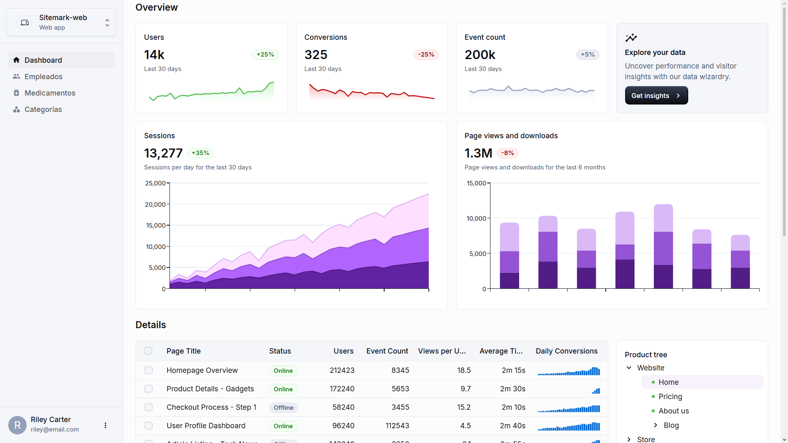
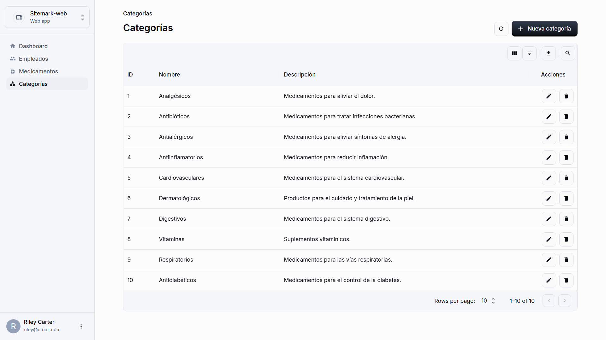
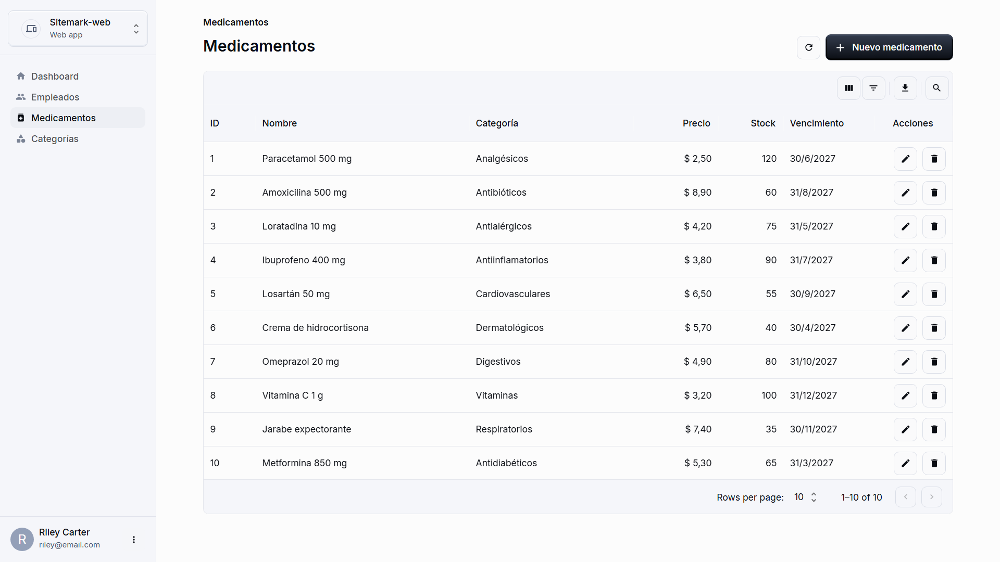
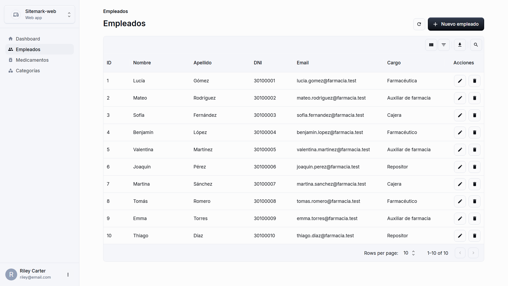

<div align="center">

# 💊 Sistema de Gestión para Farmacia

Aplicación web para administrar **medicamentos**, **categorías** y **empleados** de una farmacia.


</div>

---

## 📑 Índice

- [Descripción](#-descripción)
- [Tecnologías utilizadas](#-tecnologías-utilizadas)
- [Requisitos](#-requisitos)
- [Instalación paso a paso](#-instalación-paso-a-paso)
- [Cómo ejecutar el proyecto](#-cómo-ejecutar-el-proyecto)
- [API REST](#-api-rest)
- [Estructura del proyecto](#-estructura-del-proyecto)
- [Capturas de pantalla](#-capturas-de-pantalla)
- [Integrantes](#-integrantes)
- [Solución de problemas](#-solución-de-problemas)

---

## 📖 Descripción

Proyecto desarrollado para el **Trabajo Práctico N°2 de Programación II**. Es una aplicación web con arquitectura cliente-servidor:

- **Backend:** API REST en Flask con patrón MVC y base de datos MySQL.
- **Frontend:** interfaz en React con Material UI que consume la API.

### Funcionalidades

- 📊 **Dashboard** con la cantidad de medicamentos, categorías y empleados.
- 💊 **Medicamentos:** crear, listar, consultar, modificar y eliminar.
- 📂 **Categorías:** crear, listar, consultar, modificar y eliminar.
- 👩‍⚕️ **Empleados:** crear, listar, consultar, modificar y eliminar.
- ✅ Validaciones en frontend y backend, con mensajes de éxito y error.

---

## 🛠️ Tecnologías utilizadas

| Área | Tecnologías |
|---|---|
| **Backend** | Python, Flask, Flask-SQLAlchemy, PyMySQL, Flask-CORS |
| **Base de datos** | MySQL |
| **Frontend** | React, Vite, Material UI (MUI), MUI X Data Grid, React Router |
| **Herramientas** | Node.js, npm, npx, pip, Git y GitHub |
| **Apoyo** | Claude (asistente de IA utilizado durante el desarrollo) |

---

## ✅ Requisitos

Antes de empezar, tenés que tener instalado:

| Herramienta | Versión recomendada |
|---|---|
| [Python](https://www.python.org/downloads/) | 3.10 o superior |
| [Node.js](https://nodejs.org/) (incluye npm y npx) | 20.19 o superior (o 22.12+) |
| [MySQL Server](https://dev.mysql.com/downloads/mysql/) | **Instalado e iniciado** |
| [Git](https://git-scm.com/) | Cualquier versión reciente |

> 💡 Si usás **XAMPP** o **Laragon**, alcanza con iniciar el módulo de MySQL desde su panel.

Para comprobar que están instalados:

```bash
python --version
node -v
npm -v
git --version
```

---

## 🚀 Instalación paso a paso

### 1. Clonar el repositorio

```bash
git clone https://github.com/adrianoop03/farmacia
cd farmacia
```

### 2. Crear y activar un entorno virtual

El entorno virtual aísla las dependencias de Python del proyecto. Se crea en la raíz del repositorio:

```bash
python -m venv .venv
```

Activalo según tu sistema:

| Sistema | Comando |
|---|---|
| Windows (PowerShell) | `.\.venv\Scripts\Activate.ps1` |
| Windows (CMD) | `.venv\Scripts\activate.bat` |
| macOS / Linux | `source .venv/bin/activate` |

Cuando está activo, la terminal muestra `(.venv)` al comienzo de la línea.

> ⚠️ Si PowerShell bloquea el script de activación, ejecutá una vez  
> `Set-ExecutionPolicy -Scope CurrentUser RemoteSigned` y volvé a intentarlo.

### 3. Instalar las dependencias del backend

```bash
cd backend
pip install -r requirements.txt
```

### 4. Configurar las variables de entorno del backend

Creá un archivo llamado **`.env`** dentro de la carpeta `backend/` con los datos de tu MySQL:

```dotenv
# Usuario de MySQL
DB_USER=root
# Contraseña del usuario (dejala vacía si no tiene)
DB_PASSWORD=tu_contraseña
# Dirección del servidor de MySQL
DB_HOST=127.0.0.1
# Puerto de MySQL (3306 por defecto)
DB_PORT=3306
# Nombre de la base de datos (se crea automáticamente)
DB_NAME=farmacia
```

> 📌 Escribí cada variable en una línea, **sin espacios alrededor del `=`** y sin comentarios en la misma línea.  
> 🔒 Este archivo contiene credenciales y **no debe subirse a GitHub** (está en el `.gitignore`).

### 5. Crear la base de datos y cargar los datos de prueba

Con MySQL iniciado, ejecutá desde la carpeta `backend/`:

```bash
python seed.py
```

El script crea la base de datos (si no existe), las tablas y carga los datos iniciales: **10 categorías, 10 medicamentos y 10 empleados**.

Podés ejecutarlo más de una vez: no duplica los registros.

### 6. Instalar las dependencias del frontend

Abrí una **segunda terminal**, ubicate en la raíz del proyecto y ejecutá:

```bash
cd frontend
npm install
```

### 7. (Opcional) Configurar la URL de la API

Por defecto el frontend se conecta a `http://localhost:5000/api`. Si tu backend usa otra dirección, creá `frontend/.env`:

```dotenv
VITE_API_URL=http://localhost:5000/api
```

---

## ▶️ Cómo ejecutar el proyecto

Se necesitan **dos terminales abiertas a la vez** (y MySQL iniciado).

**Terminal 1 · Backend** (con el entorno virtual activado):

```bash
cd backend
python app.py
```

La API queda disponible en `http://localhost:5000`.

**Terminal 2 · Frontend:**

```bash
cd frontend
npm run dev
```

Abrí en el navegador la dirección que muestra la terminal. Normalmente es:

👉 **http://localhost:5173**

> Si ese puerto está ocupado, Vite usa el siguiente (por ejemplo `http://localhost:5174`). En ese caso, ese origen tiene que estar permitido en `CORS_ORIGINS` de la configuración del backend.

### Verificar que todo funciona

- `http://localhost:5000/api/health` debería responder `{"estado": "ok"}`.
- `http://localhost:5000/api/medicamentos` debería listar los 10 medicamentos.
- En el frontend, el Dashboard debería mostrar los contadores.

---

## 🔌 API REST

Base: `http://localhost:5000/api`

| Recurso | Endpoints |
|---|---|
| **Medicamentos** | `GET /medicamentos` · `GET /medicamentos/<id>` · `POST /medicamentos` · `PUT /medicamentos/<id>` · `DELETE /medicamentos/<id>` |
| **Categorías** | `GET /categorias` · `GET /categorias/<id>` · `POST /categorias` · `PUT /categorias/<id>` · `DELETE /categorias/<id>` |
| **Empleados** | `GET /empleados` · `GET /empleados/<id>` · `POST /empleados` · `PUT /empleados/<id>` · `DELETE /empleados/<id>` |
| **Estado** | `GET /health` |

---

## 🖼️ Capturas de pantalla

| Dashboard  | Categorías |
|---|---|
|   |  |

| Medicamentos | Empleados |
|---|---|
|  |  |

---

## 🗂️ Estructura del proyecto

```
farmacia/
├── backend/
│   ├── app.py               # Punto de entrada de Flask
│   ├── seed.py              # Crea la base, las tablas y los datos iniciales
│   ├── requirements.txt     # Dependencias de Python
│   ├── .env                 # Variables de entorno (no se sube a GitHub)
│   ├── config/              # Configuración de la aplicación
│   ├── models/              # Modelos (SQLAlchemy)
│   ├── controllers/         # Lógica de negocio y validaciones
│   └── routes/              # Rutas de la API
├── frontend/
│   ├── src/
│   │   ├── pages/           # Pantallas (dashboard, medicamentos, categorías, empleados)
│   │   ├── layouts/         # Layout del panel con menú lateral
│   │   ├── services/        # Comunicación con la API
│   │   └── assets/          # Imágenes y logo
│   └── package.json
├── database/
│   └── farmacia_db.sql      # Script SQL con estructura y datos iniciales
└── README.md
```

---

## 👥 Integrantes

| Integrante | Tareas principales |
|---|---|
| `Adriano Oyola` | `Backend: Creacion de app y conexion a frontend` |
| `Gregorio Bizzotto` | `Backend: Creacion de base de datos y seed` |
| `Lautaro Tonini` | `Frontend: Creacion de layout de dashboard y tester`|
| `Fabrizio Rossato` | `Frontend: Creacion de empleados, medicamentos y categorias` |

---

## 🧯 Solución de problemas

| Problema | Posible causa y solución |
|---|---|
| `Can't connect to MySQL server` / `ConnectionRefusedError` | MySQL no está iniciado, o `DB_HOST` / `DB_PORT` del `.env` son incorrectos. Probá con `DB_HOST=127.0.0.1`. |
| `Access denied for user` | Usuario o contraseña incorrectos en `backend/.env`. |
| `Unknown database` | Ejecutá `python seed.py`, que crea la base. |
| `invalid literal for int()` al iniciar | Falta un valor en el `.env` (por ejemplo `DB_PORT` vacío). |
| El frontend muestra "No se pudo conectar con el servidor" | El backend no está corriendo o `VITE_API_URL` apunta a otra dirección. |
| Error de CORS en la consola del navegador | El puerto del frontend no está incluido en `CORS_ORIGINS` del backend. |
| `pip` o `python` no se reconocen | Python no está en el PATH, o el entorno virtual no está activado. |
| Los cambios en un `.env` no se aplican | Reiniciá el servidor correspondiente (Flask o `npm run dev`). |
